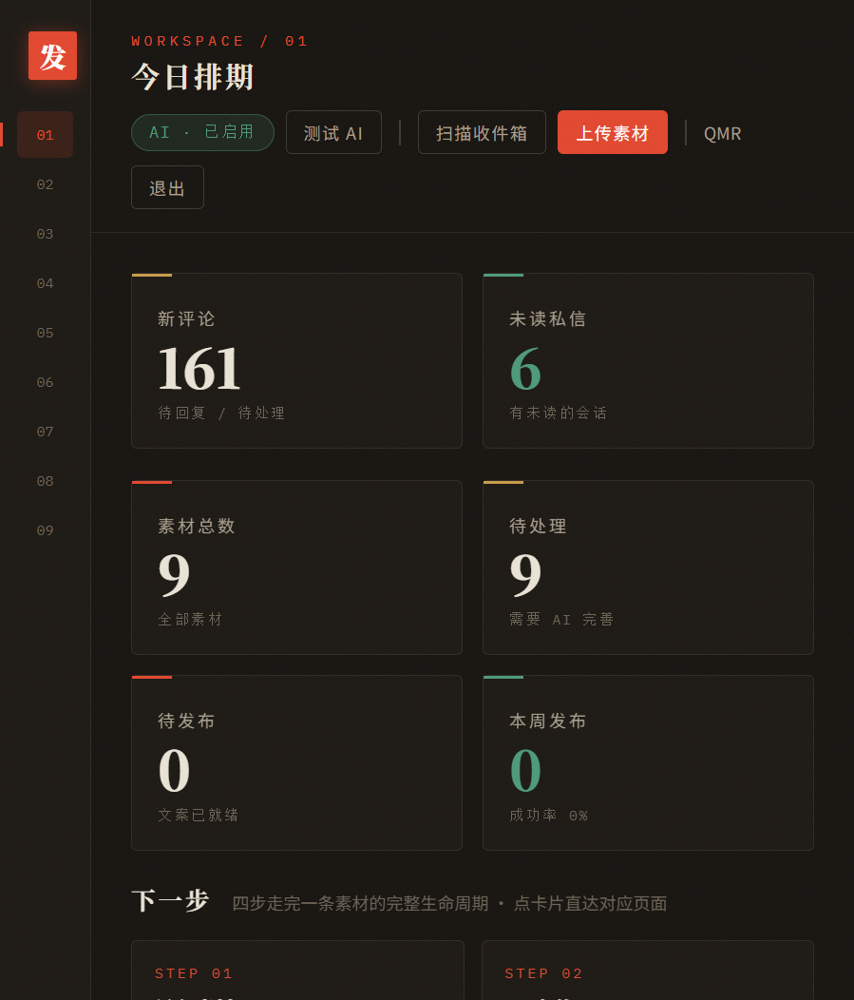

# 多平台视频发布工作台 v3.3

视频号 / 抖音 / 小红书 多用户、多账号、本地自动发布工作台。
支持：素材管理、AI 自动写标题/描述/话题、选合集、自定义封面、AI 标识、错峰发布、后台到点自动执行、发布审计日志。



## 环境要求（首次必看）

1. 安装 [Python 3.11+](https://www.python.org/) 和 [uv](https://docs.astral.sh/uv/)。
2. 安装依赖与浏览器：`uv sync --extra dev` 后执行 `uv run playwright install chromium`
   （下载 Playwright 自带 Chromium，无需另外安装 Chrome；若本机已装 Chrome 且想用，可在 `.env` 设 `BROWSER_CHANNEL=chrome`）。
   不跑测试可以省略 `--extra dev`。
3. **两种浏览器模式**：
   - **发布 = 无头后台**：默认 `PUBLISH_HEADLESS=true`，发布时浏览器静默后台运行，不打扰你。
   - **登录 = 可见窗口**：首次给账号登录时，会弹出一个可见的浏览器窗口让你**扫码**，扫完自动关掉。
     登录态保存在该账号专属档案目录，之后发布复用，不用每次扫。

## 快速开始

双击 `start.bat`，约 3 秒后浏览器会自动打开面板 http://127.0.0.1:8734 ，首次会自动跳到登录页。
使用中不要关闭那个黑色命令行窗口；想停止服务，直接关掉它即可。

> 多用户：面板自带注册/登录（账号密码存在本地 SQLite，本地部署够用）。
> 第一次打开先「注册新账号」，登录后就能用。

或手动命令：
```bash
uv sync --extra dev                          # 首次安装依赖（含测试框架）
uv run python -c "from wchannels.db import init_db; init_db()"  # 初始化数据库
uv run uvicorn wchannels.web.app:create_app --factory --host 127.0.0.1 --port 8734
uv run pytest -q                             # 回归测试（应 53 项全绿）
```

## 目录结构

```
D:\github\wechat-channels-agent\     ← 代码（可 git、可拷贝）
D:\wechat_channels_data\             ← 数据（外部，可改路径）
  ├── app.db                        ← SQLite 数据库（含用户/账号/素材/队列）
  ├── inbox\                       ← 素材收件箱（新视频丢这里自动入库）
  ├── profiles\                    ← 每账号独立浏览器档案（按 平台_时间戳 隔离）
  ├── thumbs\                      ← 缩略图和封面
  ├── logs\                        ← 运行日志 app.log（自动滚动，出问题先看这里）
  └── shots\                       ← 失败截图
```

## 数据误删恢复（app.db 没了怎么办）

`app.db` 只存「登记信息」（用户、账号记录、素材登记、队列、审计）；**视频文件在 `inbox\`、登录态在 `profiles\`，都不在数据库里**。若 app.db 被误删：

1. 双击 `start.bat` 启动（会自动重建空数据库），重新注册登录。
2. 素材恢复：点「📥 扫描收件箱」，inbox 里的视频全部重新入库；标题/话题再点一次「✨ AI 完善」即可。
3. 账号恢复（免重新扫码）：在「账号管理」新建同名同平台账号 → 关闭面板 → 打开 `profiles\`，把新建的**空目录**（按 平台_时间戳 命名，最新的那个）删除，把**旧目录**重命名成新目录名 → 重新启动面板，点「检测登录」，登录态即恢复。

## 工作流（素材三态 + 多平台）

1. **inbox（待处理）**：新视频丢进 `inbox\`，点「📥 扫描收件箱」自动入库；**或点顶栏「⬆️ 上传素材」直接上传本地视频文件**（推荐，浏览器直传，跨平台文件名安全）
2. **ready（待发）**：点「✨ AI 完善」自动生成标题/描述/话题（按目标平台风格），确认后点「转待发」
3. **配置（可选）**：素材卡片点「⚙️ 配置」设置**合集**（视频号「选合集」）、**自定义封面**、**AI 标识**；点「🖼 封面」可从视频抽帧生成封面
4. **published（已发）**：发布成功自动转状态

> **素材导入有两种方式，都是真的：**
> - 方式 A「扫描收件箱」：把视频文件（mp4/mov/...）丢进 `D:\wechat_channels_data\inbox\`，在面板点「📥 扫描收件箱」自动登记。
> - 方式 B「上传素材」：点顶栏「⬆️ 上传素材」选本地视频直接上传，后端接 `POST /api/materials/upload`（写入 inbox 并登记入库）。
> 两种方式最终都落到同一个素材库，任选其一。

> 每个账号创建时选择平台（视频号 / 抖音 / 小红书），发布时按账号所属平台自动选对应适配器。
> 各平台适配器内置该平台的发布页地址与表单字段（标题长度、话题、AI 标识、合集、封面）。

## 自动化方案

| 方案 | 说明 | 怎么用 |
|---|---|---|
| **手动发布** | 选素材勾号，点立即执行 | 「🚀 发布队列」页 → 新建排期区勾选 → 一键发布，任务行点「立即执行」 |
| **智能排期** | 自动分配到未来 3 天黄金时段（12/18/20 点），错峰发布 | 发布队列页 → 勾选素材和账号 → 点「📅 智能排期」（接口 `POST /api/automation/smart-schedule`） |
| **一键自动发布** | 选素材，自动选所有可用账号，自动错峰排期 | 「🚀 发布队列」页 → 「🚀 一键发布」按钮（接口 `POST /api/automation/auto-publish`） |
| **后台调度器** | 每 30 秒自动检查队列，到点自动执行 | 启动后自动运行，无需手动 |

> 素材误删不用慌：回收站筛选下点「♻️ 恢复」即可回到待发布（只改状态，不删磁盘文件）。

> 到点发布由**本项目调度器**负责，因此不会把定时时间再交给平台设二次延迟。
> 每账号每日发布上限会**跨天自动归零**（v3.1 修复：此前只增不减，号发满后次日仍不可用）。

## 发布审计日志

侧栏「🧾 审计日志」记录每一次发布尝试的**谁 / 哪个平台 / 什么素材 / 时间 / 结果 / 耗时**，
支持按平台与成败筛选，`GET /api/audit` 与 `GET /api/audit/summary`。
手动发布、后台自动执行、以及被跳过（登录态失效/超限额）都会留痕，用于事后追溯。

- **CSV 导出**：审计页点「导出 CSV」（`GET /api/audit/export.csv`，带 BOM，Excel 直开不乱码，沿用当前筛选条件）。
- **保留期清理**：`AUDIT_RETENTION_DAYS`（默认 90 天，0 = 永久保留），调度器每次启动时自动清理更早的记录。

## 封面功能

- 从视频指定时间点抽帧作为封面（`POST /api/cover/{mid}/extract-frame?at_sec=1.0`，界面点「🖼 封面」）
- 用户上传自定义封面图（`POST /api/cover/{mid}/upload-cover`）
- 封面存在 `thumbs\cover_{id}.jpg`，发布时由基类通用逻辑自动带入（三平台一致）

## 配置

复制 `.env.example` 为 `.env`（`.env` 可选，不写就用代码默认值）：
- `WX_DATA_DIR`：数据目录位置（数据库 / 档案 / 截图都在这里）；素材收件箱固定是其下的 `inbox` 子目录，整体搬目录时一起跟着走
- `LLM_API_KEY`：AI 写文案用的密钥。**留空则「✨ AI 完善」回退本地规则**，界面提示「AI 未启用」
- `LLM_BASE_URL`：OpenAI 兼容接口地址（**代码默认 `https://api.deepseek.com/v1`**；`.env` 里可改成本地网关，如 `http://127.0.0.1:8787/v1`）
- `LLM_MODEL`：模型名（代码默认 `deepseek-chat`；走本地网关时改成网关支持的模型名，如 `aggregate/free`）
- `BROWSER_CHANNEL`：留空=用 Playwright 自带 Chromium（**默认推荐，零配置**）；填 `chrome`/`msedge` 复用本机浏览器（指纹一致）
- `PUBLISH_HEADLESS`：发布是否无头（True 静默；扫码登录始终有头）
- `PLATFORM_DAILY_LIMITS`：各平台每日发布上限，如 `{"wechat":3,"douyin":5,"xiaohongshu":5}`（跨天自动归零）
- `PLATFORM_STAGGER_MIN`：各平台错峰间隔（分钟），如 `{"wechat":30,"douyin":20,"xiaohongshu":20}`
- `SCHEDULER_ENABLED`：后台调度器开关
- `SCHEDULER_INTERVAL_S`：调度器检查间隔（秒）
- `LOGIN_KEEPALIVE_ENABLED`：登录态保活开关（默认开；每轮真实访问一次各账号后台，可延长滑动过期的登录态，并兼作掉线巡检）
- `LOGIN_KEEPALIVE_INTERVAL_S`：保活间隔（秒，默认 10800=3 小时；不建议低于 2 小时，避免触发平台风控）
- `LOGIN_KEEPALIVE_START_DELAY_S`：启动后多久跑首轮（秒，默认 600）
- `LOGIN_KEEPALIVE_STAGGER_S`：账号间随机错峰上限（秒，默认 20，模拟自然访问）
- `AUDIT_RETENTION_DAYS`：审计日志保留天数（默认 90，0 = 永久保留；调度器启动时清理）
- `SECRET_KEY`：会话签名密钥，**本地部署可不动；公网部署务必改成一个随机长串**
- `SESSION_EXPIRE_DAYS`：登录有效期（天）

> ⚠️ 本机 `.env` 目前配的是本地网关（`127.0.0.1:8787` + `aggregate/free`）。
> **换电脑时该网关不存在**，AI 会自动回退本地规则——这不是 bug，界面会如实显示「AI 未启用」。
> 想用真 AI，请在 `.env` 填 DeepSeek key 或你自建的 OpenAI 兼容网关地址。

## AI 智能文案

「✨ AI 完善」调用 `.env` 里配置的 OpenAI 兼容接口；未配置或调用失败时自动回退本地规则，
并如实标注是否真用了模型，不冒充 AI。

- 顶栏实时显示 AI 状态：已启用（绿）/ 未启用（红）。
- 点「测试 AI」会真实调一次模型验证连通性（`POST /api/ai/test`）。
- 未配置 `LLM_API_KEY` 时，自动回退本地规则生成（仍是可读的标题/话题，但非模型生成，
  界面会明确标注 AI 未启用）。
- 生成结果里带 `ai_used` 字段，前端如实展示「真 AI 生成」或「本地规则」。

## v3.3 更新点

**小白实测修掉的真问题**
- **上传后标题不再是乱码**：此前浏览器上传的视频会用临时随机名（如 `tmpab12_xxx.mp4`）当标题，现在用你的原文件名；重复上传会明确告诉你「这个视频已经在素材库里了」，格式不对则单独提示。
- **扫完素材能直接排期**：此前素材扫描后是「待处理」，必须手动转「待发」才会出现在发布队列，小白容易卡住；现在点「AI 完善」会自动加入「待发布」，按钮也改名为「加入待发布」，卡片上直接写了下一步该干什么。
- **素材能改标题了**：素材「配置」弹窗补齐「短标题 / 描述文案 / 话题」三项（此前只能靠 AI 生成）。
- **账号掉登录有醒目提醒**：发布队列顶部会用红字列出「这些账号现在发不出去」并附「去账号管理处理」按钮；失败原因直接写明去点哪个按钮重新扫码。
- **执行发布有进度反馈**：点「立即执行 / 重试」会提示「正在操作浏览器，通常 1~3 分钟」，按钮变为「发布中…」，不会像卡死；上传大视频时同样有提示。
- **收件箱跟随数据目录**：`WX_INBOX_DIR` 不再需要单独配置，固定为 `WX_DATA_DIR\inbox`，整体搬数据目录不会再错位。
- **升级后不会跑到旧界面**：静态脚本带版本串并禁用启发式缓存，改完代码刷新即生效。
- 登录页补了「第一次使用请注册」和注册说明；品牌版本号更新为 V3.3。

**底层加固**
- 运行日志落盘 `logs\app.log`（2MB 自动滚动 ×3）。
- 打开发表页 / 上传失败自动重试一次；失败消息附带页面地址与标题，一眼分清「掉登录」还是「平台改版」。
- 话题格式统一（去 `#`、去重、兼容中英文逗号与空格），AI 生成同样处理。
- 账号页配额即时归零，显示「今日 0/3 条」；错误提示统一为中文人话。

## 合规说明

- 不做自动回评论/私信（网信办 2026-09 通报重点打击）
- 不做指纹伪装（比不做更危险）
- 发布用真实浏览器 + 本地档案，低频串行
- 发布全程留审计流水，可追溯谁在何时向哪个平台发了什么
